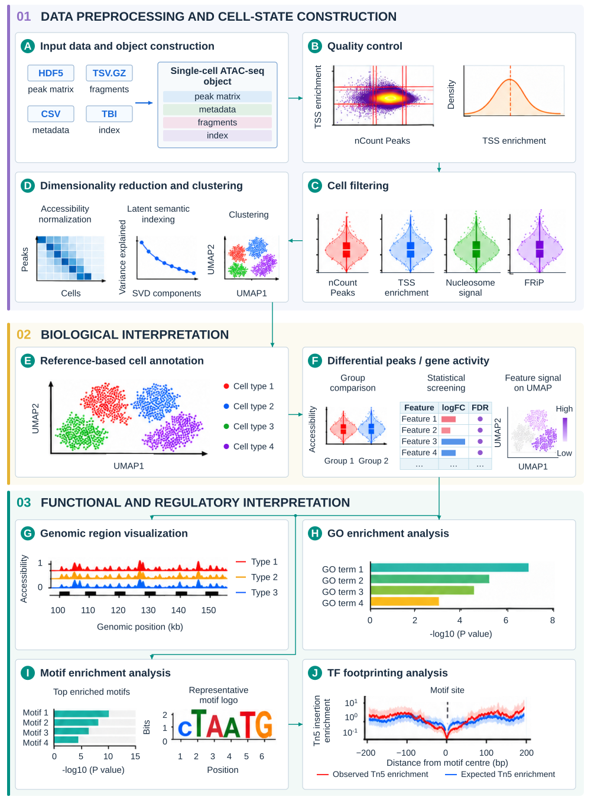

# SignacShiny
SignacShiny is an interactive R Shiny application for downstream analysis of processed scATAC-seq data. Built on Signac and Seurat, it supports quality control, cell filtering, dimensionality reduction, clustering, differential accessibility, gene activity, cell annotation, genomic region visualization, GO enrichment, motif analysis, and transcription factor footprinting. Alignment and initial peak calling are completed before import.



## Data and reproducibility status

The application imports processed scATAC-seq inputs. The server code also reads local files under `data/` for the bundled PBMC example, cached quality-control plots, and SingleR reference datasets. The expected relative paths and SHA-256 hashes are in [DATA_SHA256SUMS.txt](DATA_SHA256SUMS.txt). Place verified files at those exact paths before using the corresponding example or reference feature. A Git LFS pointer is not the data file.

The current repository does **not** yet provide a verified, complete set of these data. An authenticated GitHub LFS download check returned 404 for **all 12 tracked data objects**. Five tracked pointers also identify versions different from the server manifest. See the [file-by-file data audit](DATA_AUDIT.md). Do not treat a successful source-code clone as a complete runnable example. The provenance and redistribution permissions of the PBMC objects, cached plots, and reference `.Rdata` files are still being checked. Obtain these files from the project maintainers for authorized testing; their public distribution or a verified lawful external acquisition path is a release blocker.

The seven SingleR reference datasets have [public celldex getters](https://bioconductor.org/packages/release/data/experiment/html/celldex.html). In an isolated test environment with `celldex` and `digest` installed, run `Rscript --vanilla scripts/prepare_celldex_references.R /path/to/stage/data` to create files with the object names and `label.fine` fields expected by `server.R`. An optional second argument, such as `NovershternHematopoietic`, prepares only that reference for a small first test. The script refuses to overwrite existing files and prints the SHA-256 of each generated file. **This route has not yet been executed against the server's R environment or shown to produce the server manifest hashes; it is not yet a validated replacement for those exact files.** Keep the processed PBMC and QC objects private until their provenance and distribution rights are confirmed.

For a user-supplied processed dataset, upload the peak matrix, fragments file and its `.tbi` index, and cell metadata through the application. The UI provides direct download links for the 10x Genomics PBMC 500 Next GEM example, including its [fragments file](https://cf.10xgenomics.com/samples/cell-atac/1.1.0/atac_pbmc_500_nextgem/atac_pbmc_500_nextgem_fragments.tsv.gz) and [index](https://cf.10xgenomics.com/samples/cell-atac/1.1.0/atac_pbmc_500_nextgem/atac_pbmc_500_nextgem_fragments.tsv.gz.tbi); verify the source terms before redistributing its files. The server manifest lists an optional copy under `data/zc/1/`, but the application does not reference that fixed directory. After obtaining authorized data, verify them from the project root with `sha256sum -c DATA_SHA256SUMS.txt` on Linux, or compare each file with `Get-FileHash -Algorithm SHA256` on Windows. Missing optional entries must be identified separately when checking only the files needed for a chosen workflow.

The server snapshot recorded R 4.4.2, Bioconductor 3.20, Shiny 1.11.1, Signac 1.17.1, Seurat 5.2.1, and SingleR 2.8.0 in `renv.lock`. These are lockfile records, not a live inventory of the server. `JASPAR2020` is imported by `global.R` but was absent from that lockfile. Runtime profiling uses `lobstr` when available and continues without memory figures when it is absent.

## Local Installation (Optional)

### 1. Download SignacShiny Source Code
You can obtain the source code in either of the following ways:
  + Clone the GitHub repository:
    ```bash
    git clone https://github.com/lixiaoxin661-rgb/SignacShiny.git
    ```
    Or

   + Download the ZIP file from: https://github.com/lixiaoxin661-rgb/SignacShiny
      The downloaded folder should be named SignacShiny-main.


### 2. Install Required R Packages & Run SignacShiny
+ **Manual Package Installation**    
  1.Open your R or RStudio environment.  
  2.Install the required packages:  
  
    ```r
    install.packages(c("bslib", "shiny", "shinyjs", "shinyBS", "shinyWidgets","shinybusy", "shinycssloaders", "shinydashboard", "shinydashboardPlus","ggplot2", "plotly", "patchwork", "cowplot", "dplyr", "purrr", "plyr","stringr", "sp", "Matrix", "ggseqlogo","matrixStats", "data.table", "DT", "irlba","systemfonts", "ggforce", "scatterpie"))  
  
    if (!requireNamespace("BiocManager", quietly = TRUE))
        install.packages("BiocManager")  
        
    BiocManager::install(c("MAST", "Seurat", "Signac", "SingleR", "SingleCellExperiment","ggseqlogo","BiocFileCache","AnnotationHub","BiocFileCache",
    "SummarizedExperiment", "Biobase", "MatrixGenerics","S4Vectors", "IRanges","GenomeInfoDb", "GenomicRanges","BiocGenerics","XVector", "Biostrings", "BiocIO", "rtracklayer", "BSgenome","BSgenome.Hsapiens.UCSC.hg19","GenomicFeatures", "AnnotationDbi", "AnnotationFilter", "ensembldb","EnsDb.Hsapiens.v75", "EnsDb.Hsapiens.v86", "EnsDb.Mmusculus.v79","org.Hs.eg.db", "GO.db","BSgenome.Hsapiens.UCSC.hg38","BSgenome.Hsapiens.NCBI.GRCH38", "BSgenome.Hsapiens.UCSC.hg19","BSgenome.Hsapiens.UCSC.mm10","HDO.db","clusterProfiler", "JASPAR2020"))
    ```
    ℹ️ A complete list of packages and versions can be found in the [sessionInfo](https://github.com/lixiaoxin661-rgb/SignacShiny/blob/main/sessionInfo) file.
    3.Run the application from the directory:
  
    ```r
    shiny::runApp("/path/to/SignacShiny-main")
    ```
  
## Authors
Please do not hesitate to post an issue or contact the authors :

Siwen Xu: siwxu@gdpu.edu.cn

Yuyan Luo : 1620218029@qq.com

## Version and citation

The source repository is https://github.com/lixiaoxin661-rgb/SignacShiny. Cite the repository and the version or commit used in your analysis. A formal publication citation will be added when available.

## License

This project is distributed under the terms in [LICENSE](LICENSE).
